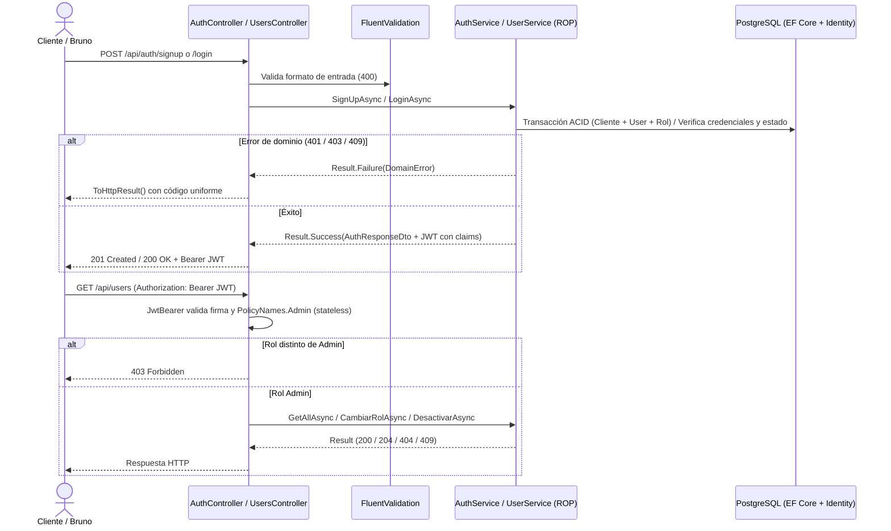

# Bitácora — Jefe de Proyecto (Antoine López)

## Tarea: Módulo de Usuarios, Autenticación/Autorización, Infraestructura Base, Docker y E2E (RF-13 · RF-14 · RF-15 · RF-46 · RI-03 · RNF-03 · RNF-04 · RNF-05 · RNF-09)

> **Fecha de registro:** 22/11/2026 · **Rama:** `feature/usuarios-fix` → `dev` · **Estado:** completado, verificado (206/206 tests + 16 peticiones Bruno E2E + Docker 4/4 healthy) y listo para integración en `dev`.

Este bloque consolida el núcleo de identidad, seguridad e infraestructura común del backend: gestión de cuentas con ASP.NET Core Identity y JWT, separación de perfiles de dominio (`Cliente` / `Trabajador`), administración de usuarios por `Admin`, modularización de `Program.cs`, contenedorización completa con Docker Compose y pruebas en las tres capas de la pirámide (unitarias, integración con Testcontainers y E2E con Bruno CLI).

---

### 1. Qué incluye

#### Identidad, autenticación y autorización (RF-46)
- **Entidades y persistencia EF Core (`AppDbContextUsuarios`):** separación entre cuenta de acceso `User : IdentityUser<Guid>` (tablas `usuarios`, `roles`, `user_roles`, etc.) y entidades de dominio `Cliente` y `Trabajador` enlazadas mediante claves foráneas opcionales (`ClienteId`, `TrabajadorId`).
- **Controlador de autenticación (`Controllers/Usuario/User/AuthController.cs`):**
  - `POST /api/auth/signup` → `201 Created` (alta pública de cliente + JWT).
  - `POST /api/auth/login` → `200 OK` (autenticación de cualquiera de los perfiles + JWT).
  - `GET /api/auth/me` → `200 OK` (perfil del usuario autenticado a partir del token).
- **Administración de usuarios (`Controllers/Usuario/User/UsersController.cs` + `IUserService`/`UserService`, solo `PolicyNames.Admin`):**
  - `GET /api/users` → `200 OK` (listado sin consultas N+1 sobre roles, RNF-02) y `GET /api/users/{id:guid}` → `200 OK` / `404`.
  - `PATCH /api/users/{id:guid}/role` → `200 OK` / `400` / `404` / `409` (valida compatibilidad persona ↔ rol `ROL_INCOMPATIBLE_CON_PERSONA` y protección del último admin `ULTIMO_ADMIN` en transacción).
  - `DELETE /api/users/{id:guid}` → `204 No Content` / `404` / `409` (baja lógica protegiendo `ULTIMO_ADMIN`) y `PATCH /api/users/{id:guid}/reactivate` → `200 OK` / `404`.
- **JWT y políticas (`Infrastructure/IdentityConfig.cs` y `PolicyNames.cs`):** firma HMAC-SHA256 con `ClockSkew = Zero`, claims propios (`cliente_id`, `trabajador_id`, `tipo_trabajador`) y 5 políticas con esquema explícito `JwtBearer`: `Admin`, `Responsable`, `Trabajador`, `Cliente` y `Mecanico` (que exige además el claim `tipo_trabajador=Mecanico` para RF-12).
- **Siembra idempotente (`IdentitySeeder.cs` · RI-03):** crea los 4 roles (`Cliente`, `Trabajador`, `Responsable`, `Admin`) y, en desarrollo, las 5 cuentas semilla completas (`Admin`, `Cliente`, `Trabajador` de Operaciones, `Mecanico` y `Responsable`) con DNIs válidos dentro de una transacción.

#### Reglas de negocio y seguridad (RF-13 · RF-14 · RF-15 · RNF-03 · RNF-09)
- **Alta transaccional de cliente (`AuthService.SignUpAsync`):** crea `Cliente`, `User` y rol `Cliente` en una única transacción de PostgreSQL; si falla cualquier paso ejecuta `RollbackAsync()` evitando clientes huérfanos.
- **Documentos de identificación (RF-13, RF-14, RF-15):** DNI, NIE y pasaporte son opcionales por separado pero obligatorios en conjunto (al menos uno). El campo `NumeroPermisoConducir` solo se conserva si el cliente se identifica con pasaporte (se normaliza a `null` cuando aporta DNI/NIE).
- **Cuentas inactivas y baja lógica:** tanto `LoginAsync` como `GetMeAsync` rechazan cuentas inactivas o dadas de baja lógica (`IsDeleted` / `!Activo`).
- **Secretos fuera del repositorio (RNF-03):** `Jwt:Key` eliminada de `appsettings.json`; se inyecta con `dotnet user-secrets` en local y variable de entorno `Jwt__Key` en Docker/producción, con validación *fail-fast* al arranque (mínimo 32 bytes / 256 bits).
- **Logs sin datos sensibles (RNF-09):** `SerilogConfig.cs` filtra ruido de EF Core/Npgsql y `AuthService`/`UserService` registran únicamente `UserId` y resultados, nunca correos ni contraseñas en claro.

#### Arquitectura e infraestructura (RNF-05)
- **Modularización de `Program.cs`:** configuración separada en `Infrastructure/SerilogConfig.cs`, `DatabaseConfig.cs`, `DatabaseInitializationExtensions.cs` e `IdentityConfig.cs`, reconectando en un único punto EF Core, Identity, controladores, validadores, caché Redis, notificaciones Email, Taller, `GlobalExceptionHandler` y `/health`.
- **Limpieza técnica:** eliminadas las 4 excepciones duplicadas en `Alquiler_Vehiculos.Exceptions.Usuario` (unificadas en `DomainExceptions.cs` para `GlobalExceptionHandler`) y alineados todos los paquetes NuGet de EF Core (`10.0.4`) y `Microsoft.IdentityModel.*` (`8.0.1`), dejando el build en **0 warnings**.
- **Dockerización completa (`Dockerfile`, `.dockerignore`, `.env.example`, `compose.yaml`):** imagen multi-stage (`sdk:10.0` → `aspnet:10.0`) con usuario no-root (`USER app`), permisos en `/app/logs` para Serilog, endpoint `/health` nativo y 4 servicios orquestados en red interna `alquiler-network`: `postgres` (`5433`), `redis` (`6379`), `mailpit` (`1025`/`8025`) y `api` (`8080`), todos con `healthcheck`.

#### Superficie REST implementada

| Método | Ruta | Acceso / Política | Respuestas HTTP |
|---|---|---|---|
| `POST` | `/api/auth/signup` | Público | `201`, `400`, `409` |
| `POST` | `/api/auth/login` | Público | `200`, `400`, `401`, `403` |
| `GET` | `/api/auth/me` | Autenticado (`[Authorize]`) | `200`, `401`, `403`, `404` |
| `GET` | `/api/users` | `PolicyNames.Admin` | `200`, `401`, `403` |
| `GET` | `/api/users/{id:guid}` | `PolicyNames.Admin` | `200`, `401`, `403`, `404` |
| `PATCH` | `/api/users/{id:guid}/role` | `PolicyNames.Admin` | `200`, `400`, `401`, `403`, `404`, `409` |
| `DELETE` | `/api/users/{id:guid}` | `PolicyNames.Admin` | `204`, `401`, `403`, `404`, `409` |
| `PATCH` | `/api/users/{id:guid}/reactivate` | `PolicyNames.Admin` | `200`, `401`, `403`, `404` |
| `GET` | `/health` | Público (HEALTHCHECK) | `200` (`Healthy`) |

---

### 2. Flujo de autenticación y autorización

---

### 3. Decisiones de diseño

**D1 — ASP.NET Core Identity con claves `Guid` frente a autenticación manual con `long`.**
- *Justificación:* Identity proporciona de serie *hashing* seguro con sal (PBKDF2), gestión de roles, unicidad de email y protección contra fuerza bruta (`Lockout`: 5 intentos / 5 min) en un componente auditado por Microsoft. La clave primaria `Guid` evita ataques de enumeración (IDOR) en URLs y no expone el número de usuarios registrados; en cuentas de usuario priorizamos seguridad frente a la pequeña ventaja de rendimiento de un `long` secuencial.
- *Alternativa descartada:* implementar autenticación manual con BCrypt y claves `long`, que aumenta la superficie de error en lógica crítica de seguridad sin aportar requisitos que Identity no cubra.

**D2 — Patrón `Result<T, DomainError>` (ROP) en servicios y controladores.**
- *Justificación:* lanzar excepciones para controlar flujos esperables de negocio (credenciales incorrectas, email duplicado, cuenta inactiva, último admin) es un antipatrón que ensucia las firmas y penaliza el rendimiento. Con `Result<T, DomainError>` los errores posibles son explícitos, se traducen uniformemente a HTTP mediante `ToHttpResult()` y resultan mucho más sencillos de probar en tests unitarios, dejando `GlobalExceptionHandler` solo para errores inesperados.
- *Alternativa descartada:* lanzar excepciones de negocio desde `AuthService`/`UserService` para capturarlas en middleware.

**D3 — Composición (`User` ↔ `Cliente` / `Trabajador`) y alta transaccional ACID en PostgreSQL.**
- *Justificación:* un `User` representa credenciales de acceso, mientras que `Cliente` y `Trabajador` son entidades de dominio con atributos y ciclos de vida distintos (un trabajador no es cliente con la misma cuenta, y un `Admin` no necesita perfil). Se opta por composición mediante FKs opcionales en lugar de herencia. Además, `SignUpAsync` y `CambiarRolAsync` envuelven las escrituras multi-tabla en transacciones ACID de PostgreSQL: si falla a mitad del proceso, el rollback evita dejar registros huérfanos o cuentas sin rol.
- *Alternativa descartada:* modelar herencia en una única tabla o persistir identidades en un almacén documental como MongoDB, menos adecuado para relaciones con claves foráneas y atomicidad multi-tabla.

**D4 — JWT *stateless* con claims de dominio y secretos fuera del repositorio (RNF-03).**
- *Justificación:* incrustar `cliente_id`, `trabajador_id` y `tipo_trabajador` en el JWT firmado permite que las políticas de autorización (como `PolicyNames.Admin` o `PolicyNames.Mecanico`) validen permisos en cada petición sin consultar la BD y sin riesgo de manipulación por el cliente. `Jwt:Key` se saca de `appsettings.json` hacia `user-secrets` (local) y `Jwt__Key` (Docker/prod), con comprobación *fail-fast* de mínimo 256 bits al arrancar.
- *Alternativa descartada:* almacenar `Jwt:Key` en `appsettings.json` o consultar la tabla de trabajadores en BD en cada petición protegida.

**D5 — Validación en dos niveles (`FluentValidation` + reglas en servicio) y regla RF-13 de documentos.**
- *Justificación:* `FluentValidation` centraliza de forma declarativa, rápida y reutilizable la validación de formato de entrada sin dependencias de BD (`SignupValidator`, `LoginValidator`, `CambiarRolValidator`), mientras que los servicios aplican las reglas que dependen del estado persistido (duplicados `409`, compatibilidad persona-rol `409`, protección del último admin `409`, cuenta activa `403`, y normalización de `NumeroPermisoConducir` a `null` cuando hay DNI/NIE).
- *Alternativa descartada:* validar todo manualmente con `if` en el controlador o mezclar comprobaciones sintácticas con consultas a BD.

**D6 — Estrategia de pruebas siguiendo la pirámide de testing + entorno Docker reproducible (RNF-04, RNF-05).**
- *Justificación:* cada capa cubre un nivel de riesgo con el coste adecuado: tests unitarios rápidos y baratos en la base (aislando servicios con `Moq`), integración en la capa intermedia contra **PostgreSQL real efímero con Testcontainers** y `WebApplicationFactory<Program>` (validando también el rechazo `403 Forbidden` entre roles reales), y E2E con **Bruno CLI** en la cúspide simulando a un usuario real tanto en `local` (`5216`) como en contenedor Docker `desarrollo` (`8080`). Los tests de Bruno generan email y DNI únicos por ejecución (`script:pre-request`) para ser repetibles sin reiniciar la BD.
- *Alternativa descartada:* depender solo de pruebas manuales en Postman/Swagger o sustituir PostgreSQL por EF Core `InMemory`, que no valida migraciones ni transacciones reales.

**D7 — Separación `AuthController` (sesión) vs `UsersController` (administración blindada a nivel de clase).**
- *Justificación:* separar las operaciones de autenticación (`/api/auth`) de la administración de cuentas (`/api/users`) permite blindar todo `UsersController` a nivel de clase con `[Authorize(Policy = PolicyNames.Admin)]` (*secure by default*: cualquier endpoint administrativo futuro nace protegido automáticamente). Además, permite verificar en pruebas de integración y E2E el rechazo `403 Forbidden` para `Cliente`, `Trabajador`, `Mecanico` y `Responsable`.
- *Alternativa descartada:* mezclar endpoints administrativos en `AuthController` repitiendo `[Authorize]` acción por acción, con mayor riesgo de olvidar una política.

**D8 — Reglas de integridad en gestión de cuentas (`ROL_INCOMPATIBLE_CON_PERSONA` y `ULTIMO_ADMIN`, HTTP `409`).**
- *Justificación:* en coherencia permanente con **D3**, una cuenta de `Trabajador` (`TrabajadorId != null`) **sí puede cambiar libremente entre `Trabajador` ↔ `Responsable` ↔ `Admin`** (el administrador puede ascender o reasignar roles internos del personal), pero nunca pasar a `Cliente`. En sentido inverso, una cuenta de `Cliente` (`ClienteId != null`) nunca puede convertirse en `Trabajador`/`Responsable`/`Admin`, ya que carece de entidad `Trabajador` (`FechaIngreso`, `TipoTrabajador`) y rompería los claims del JWT y reglas de taller/oficina; si un cliente entra a trabajar en la empresa, se le crea su cuenta corporativa aparte. Asimismo, tanto `CambiarRolAsync` como `DesactivarAsync` impiden dejar el sistema sin ningún `Admin` activo (`ULTIMO_ADMIN`). Se devuelve `409 Conflict` porque la petición es válida en formato pero entra en conflicto con el estado actual del dominio.
- *Alternativa descartada:* permitir cambios de rol arbitrarios sin validar el perfil asociado o permitir desactivar al único administrador del sistema.

**D9 — Baja lógica (`IsDeleted` / `DeletedAt`) y reactivación frente a borrado físico.**
- *Justificación:* `DELETE /api/users/{id}` aplica *soft-delete* marcando `IsDeleted = true` y registrando `DeletedAt` en UTC, preservando integridad referencial y trazabilidad histórica de reservas, pagos o partes de taller vinculados a la persona. La cuenta queda bloqueada para iniciar sesión y puede recuperarse con `PATCH /api/users/{id}/reactivate`.
- *Alternativa descartada:* borrado físico (`UserManager.DeleteAsync`), que destruye auditoría y rompe claves foráneas.

**D10 — Listado de usuarios sin consultas N+1 (`RNF-02`) y Docker multi-stage no-root con `/health` (`RNF-05`).**
- *Justificación:* en `UserService.GetAllAsync`, en lugar de invocar `userManager.GetRolesAsync(u)` dentro de un bucle (1 + N consultas a PostgreSQL), se resuelven todos los roles con una única consulta `JOIN` sobre `UserRoles` y `Roles` cruzada en memoria (2 consultas fijas, cumpliendo RNF-02). En Docker, la imagen multi-stage (`sdk:10.0` → `aspnet:10.0`) minimiza tamaño, ejecuta el proceso con usuario sin privilegios (`USER app`), asegura permisos en `/app/logs` para Serilog y expone `/health` para orquestar el arranque seguro con `depends_on` y `HEALTHCHECK`.
- *Alternativa descartada:* iterar `GetRolesAsync` por usuario (N+1) o ejecutar el contenedor como `root` con el SDK completo y sin comprobación de salud.

---

### 4. Pruebas y cobertura

**Pruebas del módulo de Usuarios / Auth (69 tests C# + 16 peticiones E2E Bruno):**

| Capa | Fichero | Tests | Qué verifica |
|---|---|---:|---|
| Unitaria | `Unit/Auth/AuthControllerTests.cs` | 7 | Mapeo HTTP de `Login`, `Signup` y `GetMe` (`200`, `201`, `401`, `403`, `409`) doblando `IAuthService` con `Moq` |
| Unitaria | `Unit/Users/UsersControllerTests.cs` | 8 | Mapeo HTTP de `GetAll`, `GetById`, `CambiarRol`, `Desactivar` y `Reactivar` (`200`, `204`, `404`, `409`) doblando `IUserService` con `Moq` |
| Unitaria | `Unit/Validators/LoginValidatorTests.cs` | 5 | Reglas de formato de email y contraseña obligatoria |
| Unitaria | `Unit/Validators/SignupValidatorTests.cs` | 20 | Formato de campos, política de contraseña, fecha de nacimiento y exigencia de al menos un documento (DNI/NIE/pasaporte) |
| Unitaria | `Unit/Validators/CambiarRolValidatorTests.cs` | 6 | Validación de los 4 roles permitidos, rol vacío y rol inexistente |
| Integración | `Integration/Auth/AuthServiceIntegrationTests.cs` | 11 | Flujos de `SignUpAsync`, `LoginAsync` y `GetMeAsync` contra PostgreSQL real |
| Integración | `Integration/Auth/AuthIntegrationTests.cs` | 3 | Pipeline HTTP completo con `WebApplicationFactory<Program>` + Testcontainers (`postgres:17-alpine`): `GetMe` sin token (`401`), baja lógica (`403`) y flujo `Signup` → `GetMe` (`201` + `200`) |
| Integración | `Integration/Auth/UsersIntegrationTests.cs` | 9 | Autorización real por roles (`401` sin token, `403` para `Cliente`/`Trabajador`/`Mecanico`/`Responsable`, `200` `Admin`), cambio de rol válido (`200`) e incompatible (`409`), baja lógica (`204`), reactivación (`200`) y protección `ULTIMO_ADMIN` (`409`) |
| E2E | `Alquiler-Vehiculos.Tests.E2E/Bruno-Cli/` (`1 - AUTHENTICATION` + `2 - USERS`) | 16 (27 checks) | Flujo completo de autenticación (5 perfiles semilla + signup repetible + `/me`) y administración `/api/users` (`401`, `403` Cliente/Trabajador, `200` Admin, `409 ULTIMO_ADMIN`) en `--env local` y `--env desarrollo` |

**Verificación global de la rama:**
- `dotnet build` → **0 Warning(s), 0 Error(s)**.
- `dotnet test Alquiler-Vehiculos/Alquiler-Vehiculos.slnx` → **206/206 en verde** (incluida la corrección de la condición de carrera en `EmailSmtpIntegrationTests` al esperar el asunto `REF-E2E` en Mailpit).
- `docker compose up -d --build` → **4/4 contenedores `healthy`** (`api`, `postgres`, `redis`, `mailpit`) y `GET http://localhost:8080/health` → `200 OK Healthy`.
- `bru run --env local` y `bru run --env desarrollo` → colección E2E repetible en ambos entornos.

---

### 5. Requisitos cubiertos

| Requisito | Descripción | Estado |
|---|---|---|
| **RF-13** | Alta de cliente con datos personales y regla de permiso de conducir solo con pasaporte | Implementado |
| **RF-14 / RF-15** | Identificación mediante DNI, NIE o pasaporte (independientes, al menos uno obligatorio) | Implementado (formato de letra pendiente de enlazar al fusionar Clientes) |
| **RF-46** | Autenticación JWT, autorización por roles/políticas (`401`/`403`) y gestión administrativa de cuentas (`/api/users`) | Implementado |
| **RI-03** | Semilla inicial idempotente de roles y 5 perfiles de prueba en desarrollo | Implementado |
| **RNF-03** | Secretos (`Jwt:Key`, credenciales SMTP) fuera del repositorio (`user-secrets` / `.env`) | Implementado |
| **RNF-04** | Pruebas automatizadas en 3 capas (unitarias, integración con Testcontainers y E2E con Bruno CLI) | Implementado |
| **RNF-05** | Entorno reproducible con un solo comando (`Dockerfile` + `compose.yaml` + `/health`) | Implementado |
| **RNF-09** | Registro estructurado con Serilog sin volcar datos personales en claro | Implementado |

---

### 6. Pendientes y coordinación con el resto del equipo

- **Integración con Clientes (`feature/clientes/controlador`):** conectar los validadores de letra oficial de DNI/NIE/pasaporte en `SignupValidator` y alinear código HTTP de menor de edad (`400`, RF-13).
- **Integración con Vehículos (`feature/Vehiculo/seed`):** unificar `DbContext` (evitar duplicar `AppDbContextUsuarios`) y contrato de `DomainError` antes del merge a `dev`.

---

## Tarea: Módulo de Oficina Única, Horario Semanal y Responsable de Operaciones (RF-11 · CU-18 · CU-22 · RF-34 · RI-03)

> **Fecha de registro:** 23/11/2026 · **Rama:** `feature/Oficina` → `dev` · **Estado:** implementado y verificado (`235/235` tests en verde, `0` warnings).

### 1. Qué incluye

- **Modelo (`Models/Oficina/Oficina.cs`) y migración (`20261123120000_AddOficina`):** tabla `oficina` en `AppDbContextUsuarios` con todos los campos de `RF-11`/`RI-02` (`Nombre`, `Direccion`, `Ciudad`, `CodigoPostal`, `Telefono`, `Email`, `Latitud`, `Longitud` como `Localizacion`, horario semanal y `ResponsableId`), clave fija `OficinaUnicaId`, restricción `CHECK ("Id" = '11111111-1111-1111-1111-111111111111')` y FK obligatoria hacia `trabajadores` con `DeleteBehavior.Restrict`.
- **Siembra idempotente (`IdentitySeeder.SeedOficinaAsync` · RI-03):** crea la oficina única (*Oficina Central Leganés*, Lunes a Viernes de `09:00` a `20:00`) vinculada al responsable semilla (`responsable@alquiler.local`).
- **Validadores y regla uniforme de email (`CambiarResponsableValidator`, `LoginValidator`, `SignupValidator`):** validación de identificador obligatorio del nuevo responsable y regex estricta de dominio de email (`^[^@\s]+@[^@\s]+\.[^@\s]{2,}$`) unificada en `LoginValidator` y `SignupValidator` junto a los validadores oficiales de documentos (`DniValidator`, `NieValidator`, `PasaporteValidator`).
- **Servicio (`IOficinaService` / `OficinaService`) y Controlador (`OficinaController`):** sin `POST`, `PUT` ni `DELETE` (cumpliendo literalmente `RF-11`). Expone `GET /api/oficina`, `PATCH /api/oficina/responsable` (para `CU-18`), `EsResponsableAsync(Guid)` para Trabajadores y `EstaAbiertaAsync(DateTime)` para Reservas (`CU-22`).

| Método | Ruta | Acceso / Política | Respuestas HTTP |
|---|---|---|---|
| `GET` | `/api/oficina` | Público (`[AllowAnonymous]`) | `200`, `404` |
| `PATCH` | `/api/oficina/responsable` | `PolicyNames.Admin` | `200`, `400`, `401`, `403`, `404`, `422` |

### 2. Decisiones de diseño

**D11 — Recurso único en REST (`/api/oficina` sin `{id}`, `POST`, `PUT` ni `DELETE`) y tabla *singleton* con clave fija + `CHECK` en PostgreSQL.**
- *Justificación:* `RF-11` establece explícitamente que la empresa solo tiene una oficina sembrada al inicio y que no hay endpoints de alta, modificación ni baja de oficinas (solo consulta pública `GET /api/oficina` y relevo de responsable `PATCH /api/oficina/responsable` para `CU-18`). En PostgreSQL/EF Core, fijar su clave primaria a un `Guid` constante reforzado con `CK_oficina_unica` garantiza a nivel de base de datos que nunca puedan existir dos filas.
- *Alternativa descartada:* exponer `POST`/`PUT`/`DELETE` sobre `/api/oficinas/{id}` (incumpliría `RF-11`) o usar una entidad `[Keyless]` (impediría actualizar `ResponsableId` en `CU-18`).

**D12 — Horario estructurado con `TimeOnly` + `DayOfWeek` en lugar de `DateTime` o texto libre.**
- *Justificación:* `DateTime` representa un instante concreto del calendario y arrastra fecha falsa y zonas horarias; el horario semanal de una oficina se repite cada semana. `TimeOnly` (mapeado nativamente a `time` en PostgreSQL) + `DiaInicio`/`DiaFin` (`System.DayOfWeek` normalizado Lunes=1..Domingo=7) permiten validar recogidas/devoluciones con `EstaAbierta(DateTime)` (**CU-22**) y generar `HorarioFormateado` para la API y las plantillas de correo (**RF-34**).
- *Alternativa descartada:* guardar `DateTime` con fecha ficticia o un `string` libre imposible de validar en Reservas.

**D13 — Responsable obligatorio de tipo `Operaciones` con sincronización transaccional de roles Identity (`CU-18`).**
- *Justificación:* por lógica de negocio real, quien dirige la oficina debe ser un trabajador activo de tipo `Operaciones` (el tipo `Mecanico` corresponde al taller, `RF-12`). Intentar designar a un trabajador inactivo o mecánico devuelve `422 Unprocessable Entity` (`TRABAJADOR_INACTIVO` / `RESPONSABLE_DEBE_SER_OPERACIONES`). El relevo se ejecuta en transacción ACID actualizando `Oficina.ResponsableId` y sincronizando el rol `Responsable` en Identity (el saliente vuelve a `Trabajador` si no es `Admin`). Además, la FK `RESTRICT` y `EsResponsableAsync` blindan **CU-18**.
- *Alternativa descartada:* permitir `ResponsableId` nullable o permitir que un `Mecanico` dirija la oficina.

**D14 — Validación estricta de dominio de email unificada y documentos oficiales en `SignupValidator`.**
- *Justificación:* `.EmailAddress()` por defecto en FluentValidation (`AspNetCoreCompatible`) acepta cadenas sin punto de dominio como `"pepe@sinpunto"`. Añadir la regex `^[^@\s]+@[^@\s]+\.[^@\s]{2,}$` y conectar `DniValidator`, `NieValidator` y `PasaporteValidator` en `SignupValidator` garantiza las mismas reglas oficiales en `/api/auth/signup` y `/api/clientes`.
- *Alternativa descartada:* validar solo con `.EmailAddress()` o validar letra de DNI/NIE únicamente en `/api/clientes`.

### 3. Pruebas del módulo

| Capa | Fichero | Tests | Qué verifica |
|---|---|---:|---|
| Unitaria | `Unit/Oficina/OficinaModelTests.cs` | 6 | `EstaAbierta` (dentro/fuera de hora, sábado cerrado, Lunes a Domingo) y `HorarioFormateado` |
| Unitaria | `Unit/Oficina/OficinaControllerTests.cs` | 4 | Mapeo HTTP (`200`, `404`, `422`) doblando `IOficinaService` con `Moq` |
| Unitaria | `Unit/Validators/OficinaValidatorsTests.cs` | 2 | `CambiarResponsableValidator` (`Guid.Empty` y `Guid` válido) |
| Integración | `Integration/Oficina/OficinaIntegrationTests.cs` | 7 | Testcontainers PostgreSQL + `WebApplicationFactory`: `GET` público (`200`), `PATCH /responsable` (`401` sin token, `403` Cliente/Trabajador/Mecánico/Responsable, `422` Mecánico, `200` Operaciones + `EsResponsableAsync`) |
| E2E | `Alquiler-Vehiculos.Tests.E2E/Bruno-Cli/3 - OFICINA/` | 3 | `[017]` GET público `200`, `[018]` PATCH responsable sin token `401`, `[019]` PATCH responsable como Responsable `403` |

