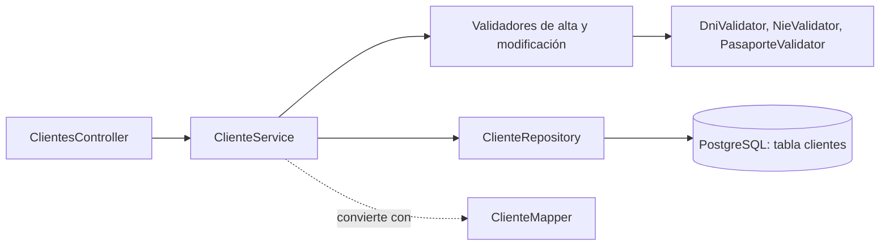

# Módulo de clientes

Documentación del módulo de clientes de la práctica 4 (API de alquiler de vehículos).
Autor: Cristian. Estado a 21/11/2026: código y pruebas hechos; falta verificarlo de extremo a extremo
porque el `Program.cs` de la rama base no registra todavía controladores, Identity ni servicios.

## 1. Alcance

| Requisito | Qué cubre este módulo |
|---|---|
| RF-13 | Alta, consulta, modificación y baja lógica de clientes. Mayoría de edad y recargo de conductor joven (en el modelo) |
| RF-14 | Tres documentos opcionales e independientes: DNI, NIE y pasaporte |
| RF-15 | Regla de combinación: debe venir al menos un documento |
| RF-16, RF-17, RF-18 | Validadores de DNI, NIE y pasaporte |
| RF-20 | Validadores como clases reutilizables, probadas aparte, con los ejemplos del enunciado |
| RF-46 | Permisos de los endpoints de clientes (matriz en el apartado 4) |
| CU-19 | El cliente pide su baja: lógica, con el histórico a la vista del administrador |

Fuera del alcance de este módulo: las cuentas de acceso y el login (módulo de usuarios), el trabajador
y la oficina, y las reservas.

## 2. Arquitectura



Controlador → servicio → validador y repositorio, como en el material del profesor. Los errores se
devuelven con `Result<T, DomainError>`, sin excepciones, y `ToHttpResult` los convierte en su código HTTP.
Los repositorios devuelven valores planos (`null`, `false`); es el servicio quien los convierte en errores.

| Capa | Archivo |
|---|---|
| Controlador | `Controllers/Usuario/Cliente/ClientesController.cs` |
| Servicio | `Services/Usuarios/Clientes/IClienteService.cs` y `ClienteService.cs` |
| Repositorio | `Repositories/Clientes/ClienteRepository.cs` |
| DTOs | `Dto/Clientes/ClienteDto.cs` y `Dto/Common/PagedResponse.cs` |
| Mapper | `Mappers/ClienteMapper.cs` |
| Validadores de DTO | `Validators/Clientes/ClienteCreateValidator.cs` y `ClienteUpdateValidator.cs` |
| Validadores de documentos | `Validators/Documentos/DniValidator.cs`, `NieValidator.cs` y `PasaporteValidator.cs` |
| Registro en DI | `Infrastructure/ClientesConfig.cs` |
| Errores | `Errors/Usuarios/ClienteError.cs` (ya existía) |
| Modelo | `Models/Usuarios/Clientes/Cliente.cs` (ya existía) |

## 3. Reglas de negocio

- **Documentos (RF-14, RF-15):** los tres son opcionales y se validan solo si traen valor, pero debe venir
  al menos uno. Con DNI o NIE, el permiso de conducir es ese documento. Si solo hay pasaporte, el número
  del permiso es obligatorio y se guarda en el campo `NumeroPermisoConducir`.
- **Correo:** identifica al cliente y no se modifica. Es único.
- **Duplicados (409):** correo y documentos son únicos, **incluidos los clientes dados de baja**, porque el
  índice único de la base de datos también cuenta esas filas. Con `EMAIL_DUPLICADO` y `DOCUMENTO_DUPLICADO`.
- **Normalización:** al convertir un DTO se recortan espacios, el correo va en minúsculas, los documentos
  en mayúsculas y un documento en blanco se guarda como nulo (así el índice único admite varios nulos).
- **Mayoría de edad (RF-13):** no se comprueba al dar de alta el cliente, sino el día de la recogida de
  la reserva. Quien cumple 18 ese día puede alquilar. El recargo del 25 % es para quien no tiene 25 ese día.
  Las reglas están en el modelo (`EsMayorDeEdad`, `EsConductorJoven`) y las usará el módulo de reservas.
- **Baja (RF-13, CU-19):** es siempre lógica. Se conserva la fila con `IsDeleted`, `DeletedAt` y
  `Activo = false`. Un cliente dado de baja no puede iniciar sesión (lo comprueba `AuthService`) y solo
  lo ve el administrador. No existe el borrado duro.

## 4. Matriz de permisos (decisión nuestra)

El enunciado deja la matriz en manos del grupo (RF-46). Sin sesión, todas devuelven 401.

| Endpoint | Cliente | Trabajador / responsable | Administrador |
|---|---|---|---|
| `GET /api/clientes` (listado) | 403 | Sí | Sí, y puede pedir las bajas |
| `GET /api/clientes/{id}` | Solo el suyo | Cualquiera | Cualquiera, también las bajas |
| `POST /api/clientes` (alta de mostrador) | 403 | Sí | Sí |
| `PUT /api/clientes/{id}` | Solo el suyo | Cualquiera | Cualquiera |
| `DELETE /api/clientes/{id}` | Solo el suyo (CU-19) | 403 | Cualquiera |

El alta de un cliente con su propia cuenta ya existe en `/api/auth/signup` (módulo de usuarios).
Para saber si un cliente accede a "lo suyo" se compara el cliente de su cuenta (`User.ClienteId`) con el
del recurso.

## 5. Endpoints

| Método y ruta | Éxito | Errores |
|---|---|---|
| `GET /api/clientes?texto&activo&incluirBajas&page&pageSize` | 200 con `{ data, pagination }` | 401, 403 |
| `GET /api/clientes/{id}` | 200 | 401, 403, 404 |
| `POST /api/clientes` | 201 con `Location` | 400 (con detalle por campo), 401, 403, 409 |
| `PUT /api/clientes/{id}` | 200 | 400, 401, 403, 404, 409 |
| `DELETE /api/clientes/{id}` | 204 | 401, 403, 404 |

La página se normaliza a un mínimo de 1 y el tamaño de página a entre 1 y 100. La búsqueda por texto no
distingue mayúsculas y mira nombre, apellidos, correo y los tres documentos.

## 6. Validación de documentos

| Documento | Regla | Ejemplo |
|---|---|---|
| DNI (RF-16) | Ocho dígitos y una letra. La letra es la posición `número % 23` en `TRWAGMYFPDXBNJZSQVHLCKE` | `12345678` da resto 14, así que `12345678Z` es válido y `12345678A` no. Resto 0 da `T` y resto 22 da `E` |
| NIE (RF-17) | `X`, `Y` o `Z` (que valen 0, 1 y 2), siete dígitos y la letra con el mismo cálculo del DNI | `X1234567L` |
| Pasaporte (RF-18) | Nueve caracteres del número de documento más un dígito de control, con el algoritmo de la MRZ | `AAA123456` da clave 5, así que `AAA1234565` es válido |

Algoritmo de la MRZ: a cada carácter se le da un valor (dígito: su número; `<`: 0; letras de `A` a `Z`: de
10 a 35), se multiplica por el peso cíclico 7, 3, 1, se suma todo y el resto de dividir entre 10 es el dígito
de control. Ejemplo del enunciado: `800101` suma 64 y su clave es 4.

**Fuente (por comprobar antes de entregar):** OACI, Doc 9303, parte de los documentos de viaje legibles por
máquina de tamaño TD3 (pasaportes): en la segunda línea de la zona de lectura mecánica, las posiciones 1 a 9
son el número de documento y la 10 su dígito de control. El enunciado pide verificar la estructura en la
fuente y citarla: hay que abrir el documento y confirmar las posiciones antes de poner la cita definitiva.

## 7. Decisiones de diseño y su porqué

Las marcadas con ★ **salen del material del profesor o no están en él**, y se declaran aquí.

1. **Dos validadores independientes para el alta y la modificación**, como `CreateProductoValidator` y
   `UpdateProductoValidator` de José Luis. Repiten reglas, pero no hay interfaz común ni validador base.
2. **Los validadores usan solo los métodos que él enseña:** `NotEmpty`, `MinimumLength`, `MaximumLength`,
   `EmailAddress`, `Must`, `When` y `WithMessage`. El teléfono se valida con `Must` y no con `Matches`.
3. **El listado se filtra y se pagina en el servicio**, como su `GetPaged`: el repositorio devuelve la lista y
   el servicio corta la página. Para el tamaño de esta práctica es suficiente.
4. **La baja lógica se filtra en el repositorio con `Where(c => !c.IsDeleted)`, no con `HasQueryFilter`**
   (que es lo que hace José Luis). Motivo: el `DbContext` es compartido con Usuarios, y un filtro global
   cambiaría lo que ve `AuthService`: el DNI de un cliente dado de baja parecería libre y el alta chocaría
   luego con el índice único.
5. **El servicio no conoce los roles.** Quién puede llamar a cada operación lo decide el controlador con
   `[Authorize]` y `User.IsInRole`, como en su teoría de autorización.
6. **★ Normalizar en el mapper:** decisión nuestra; los métodos que usa son todos suyos.
7. **★ `ClientesConfig` en lugar de `RepositoriesConfig` y `ServicesConfig`:** la forma es la de él (método de
   extensión sobre `IServiceCollection`), pero es una clase solo de clientes para no chocar con los demás
   módulos, que crearían los mismos nombres.
8. **★ Los algoritmos de DNI, NIE y pasaporte** no están en el material del profesor, pero el enunciado los
   exige (RF-16 a RF-18). Están escritos con construcciones básicas que sí aparecen en su material
   (`for`, `if`, `int.TryParse`, `char.IsDigit`, `Substring`).
9. **★ `DateOnly` para la fecha de nacimiento:** solo aparece en un comentario del profesor. Se usa porque el
   modelo `Cliente`, que ya existía, lo declara así.
10. **Versiones de paquetes de pruebas:** Moq 4.20.72, igual que el profesor. `Testcontainers.PostgreSql`
    4.17.0 en lugar de su 4.4.0, para coincidir con `Testcontainers.Redis` que ya usaba el equipo, y
    `Microsoft.EntityFrameworkCore` 10.0.15 fijado en las pruebas por un choque de versiones de EF Core
    en la rama base.

## 8. Pruebas

| Qué | Casos | Tipo |
|---|---|---|
| `DniValidator` | 23 | Unitarias |
| `NieValidator` | 21 | Unitarias |
| `PasaporteValidator` | 29 | Unitarias |
| `ClienteCreateValidator` | 34 | Unitarias |
| `ClienteUpdateValidator` | 30 | Unitarias |
| `ClienteMapper` | 8 | Unitarias |
| `ClienteService` (repositorio simulado con Moq) | 24 | Unitarias |
| Reglas de edad del modelo `Cliente` | 14 | Unitarias |
| `ClienteRepository` contra PostgreSQL real (Testcontainers) | 28 | Integración |
| **Total** | **211** | 183 unitarias y 28 de integración |

Las pruebas siguen su estilo: NUnit, FluentAssertions y Moq, patrón Arrange, Act y Assert, y clases anidadas
de casos positivos y negativos. Donde un fallo debe cortar el camino se comprueba con `Times.Never` que el
repositorio no se llama. Las de integración usan una base de datos PostgreSQL de verdad y leen el resultado
con un contexto nuevo para comprobar lo que se guardó.

Ejecutarlas:

```bash
dotnet test Alquiler-Vehiculos.slnx --filter "FullyQualifiedName~Unit"
dotnet test Alquiler-Vehiculos.slnx --filter "FullyQualifiedName~Integration.Repositories"
```

Las de integración necesitan Docker encendido.

## 9. Lo que queda fuera y por qué

- **La baja con reservas vivas (409, RF-13 y CU-19)** no está implementada: depende del módulo de reservas,
  que todavía no existe. `ClienteError.ConReservasVivas` ya está preparado y se enlazará cuando esté.
- **Pruebas del controlador con `WebApplicationFactory` y verificación de extremo a extremo (401, 403, 200 y
  404 reales):** pendientes. Necesitan un `Program.cs` que registre controladores, Identity, JWT, el
  `DbContext` y los servicios, y el de la rama base todavía es la plantilla.
- **El teléfono no es único.** `ClienteError.TelefonoExistente` existe pero no se usa, porque el enunciado no
  lo pide y la base de datos no tiene ese índice.
- **El listado carga todos los clientes en memoria** antes de filtrar y paginar. Con un volumen grande habría
  que pasar el filtro y el `Skip` y `Take` a la consulta.

## 10. Cambios en archivos de otros módulos

Para poder compilar la rama base hubo que tocar dos archivos ajenos, con una línea cada uno:

| Archivo | Cambio |
|---|---|
| `Cache/RedisCacheStore.cs` | Se quita un `using Microsoft.EntityFrameworkCore.Storage;` que daba `CS0104` |
| `Program.cs` | Se añade `using Alquiler_Vehiculos.Cache;`, que faltaba y daba `CS1061` |

Además hay fallos de la rama base que no se han tocado y bloquean arrancar la API: `appsettings.json` no es
JSON válido, `Program.cs` no registra nada, y las versiones de `IdentityModel` están desalineadas, así que el
login emite el token pero lo rechaza después.

## 11. Para conectar el módulo cuando exista el `Program.cs`

```csharp
builder.Services.AddControllers();
builder.Services.AddValidatorsFromAssemblyContaining<Program>();
builder.Services.AddClientes();
```

La política de autorización y Identity las configura `IdentityConfig`, que ya existe.

## 12. Dudas para el profesor

1. Los algoritmos de DNI, NIE y pasaporte no aparecen en su material: ¿es válida su implementación con
   construcciones básicas?
2. ¿Se puede usar `DateOnly` para la fecha de nacimiento, o prefiere `DateTime`?
3. ¿Cómo prefiere que se pruebe la baja con reservas vivas mientras no exista el módulo de reservas?