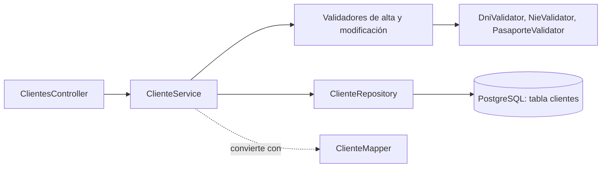

# Clientes y documentos de identidad — Documentación para la memoria

> Bloque **Clientes y documentos (RF-13 a RF-18, RF-20)** más los permisos de sus endpoints (RF-46) y **CU-19**.
> Este documento está listo para volcarse en la *Memoria de diseño*.
> Autor: Cristian. Estado a 21/11/2026: código y pruebas hechos; falta la verificación de extremo a extremo.

---

## 1. Resumen del módulo

Alta, consulta, modificación y baja lógica de clientes, con tres documentos de identidad opcionales (DNI, NIE y
pasaporte) validados con sus algoritmos de control. Un cliente solo accede a sus propios datos; el personal
gestiona a cualquiera; la baja es siempre lógica.

| Requisito | Qué cubre este módulo |
|---|---|
| RF-13 | Alta, consulta, modificación y baja lógica. Mayoría de edad y recargo de conductor joven, en el modelo |
| RF-14 | Tres documentos opcionales e independientes |
| RF-15 | Regla de combinación: debe venir al menos uno |
| RF-16, RF-17, RF-18 | Validadores de DNI, NIE y pasaporte |
| RF-20 | Validadores reutilizables y probados aparte, con los ejemplos del enunciado |
| RF-46 | Permisos de los endpoints de clientes |
| CU-19 | El cliente pide su baja: lógica, histórico a la vista del administrador |

Fuera de este módulo: las cuentas y el login (usuarios), el trabajador y la oficina, y las reservas.

## 2. Arquitectura



Controlador, servicio, y validador y repositorio, como en el material del profesor. Los errores se devuelven con
`Result<T, DomainError>`, sin excepciones, y `ToHttpResult` los convierte en su código HTTP. Los repositorios
devuelven valores planos (`null`, `false`) y es el servicio quien los convierte en errores.

| Capa | Archivo |
|---|---|
| Controlador | `Controllers/Usuario/Cliente/ClientesController.cs` |
| Servicio | `Services/Usuarios/Clientes/IClienteService.cs` y `ClienteService.cs` |
| Repositorio | `Repositories/Clientes/ClienteRepository.cs` |
| DTOs | `Dto/Clientes/ClienteDto.cs` y `Dto/Common/PagedResponse.cs` |
| Mapper | `Mappers/ClienteMapper.cs` |
| Validadores de DTO | `Validators/Clientes/ClienteCreateValidator.cs` y `ClienteUpdateValidator.cs` |
| Validadores de documentos | `Validators/Documentos/DniValidator.cs`, `NieValidator.cs` y `PasaporteValidator.cs` |
| Registro en DI | `Infrastructure/ClientesConfig.cs` |
| Ya existían (no son nuestros) | `Errors/Usuarios/ClienteError.cs` y `Models/Usuarios/Clientes/Cliente.cs` |

## 3. Reglas de negocio

- **Documentos (RF-14, RF-15):** los tres son opcionales y se validan solo si traen valor, pero debe venir al
  menos uno. Con DNI o NIE, el permiso de conducir es ese documento. Con solo pasaporte, el número del permiso
  es obligatorio y se guarda en `NumeroPermisoConducir`.
- **Correo:** identifica al cliente, es único y no se modifica.
- **Duplicados (409):** correo y documentos son únicos, **incluidos los clientes dados de baja**. Códigos
  `EMAIL_DUPLICADO` y `DOCUMENTO_DUPLICADO`.
- **Normalización:** al convertir un DTO se recortan espacios, el correo va en minúsculas, los documentos en
  mayúsculas y un documento en blanco se guarda como nulo.
- **Mayoría de edad y recargo (RF-13):** no se miden al dar de alta, sino el día de la recogida de la reserva.
  Quien cumple 18 ese día puede alquilar. El recargo del 25 % es para quien no tiene 25 ese día.
  *Ejemplo ilustrativo (el cálculo real lo hace el módulo de reservas):* vehículo a 40 € el día durante 3 días,
  120 €; recargo del 25 %, 30 € en una línea aparte; total 150 €. Si el cliente cumple 25 durante el alquiler,
  el recargo se aplica igual a todo el alquiler.
- **Baja (RF-13, CU-19):** siempre lógica. Se conserva la fila con `IsDeleted`, `DeletedAt` y `Activo = false`.
  Un cliente de baja no puede iniciar sesión (lo comprueba `AuthService`) y solo lo ve el administrador.
  No existe el borrado duro.

## 4. Matriz de permisos

El enunciado deja la matriz en manos del grupo (RF-46). Sin sesión, todas devuelven 401.

| Endpoint | Cliente | Trabajador / responsable | Administrador |
|---|---|---|---|
| `GET /api/clientes` | 403 | Sí | Sí, y puede pedir las bajas |
| `GET /api/clientes/{id}` | Solo el suyo | Cualquiera | Cualquiera, también las bajas |
| `POST /api/clientes` (alta de mostrador) | 403 | Sí | Sí |
| `PUT /api/clientes/{id}` | Solo el suyo | Cualquiera | Cualquiera |
| `DELETE /api/clientes/{id}` | Solo el suyo (CU-19) | 403 | Cualquiera |

El alta de un cliente con su propia cuenta ya existe en `/api/auth/signup`. Para saber si un cliente accede a
"lo suyo" se compara el cliente de su cuenta (`User.ClienteId`) con el del recurso.

## 5. Endpoints

| Método y ruta | Éxito | Errores |
|---|---|---|
| `GET /api/clientes?texto&activo&incluirBajas&page&pageSize` | 200 con `{ data, pagination }` | 401, 403 |
| `GET /api/clientes/{id}` | 200 | 401, 403, 404 |
| `POST /api/clientes` | 201 con `Location` | 400 (detalle por campo), 401, 403, 409 |
| `PUT /api/clientes/{id}` | 200 | 400, 401, 403, 404, 409 |
| `DELETE /api/clientes/{id}` | 204 | 401, 403, 404 |

Página mínima 1 y tamaño entre 1 y 100. La búsqueda no distingue mayúsculas y mira nombre, apellidos, correo y los
tres documentos.

## 6. Validación de documentos

| Documento | Regla | Ejemplo |
|---|---|---|
| DNI (RF-16) | Ocho dígitos y una letra: la posición `número % 23` en `TRWAGMYFPDXBNJZSQVHLCKE` | `12345678` da resto 14, así que `12345678Z` es válido y `12345678A` no. Resto 0 da `T`; resto 22 da `E` |
| NIE (RF-17) | `X`, `Y` o `Z` (0, 1 y 2), siete dígitos y la letra con el mismo cálculo | `X1234567L` |
| Pasaporte (RF-18) | Nueve caracteres del número y un dígito de control, con el algoritmo de la MRZ | `AAA123456` da clave 5, así que `AAA1234565` es válido |

Algoritmo de la MRZ: cada carácter vale su número si es dígito, 0 si es `<`, y de 10 a 35 si es letra (`A` a `Z`);
se multiplica por el peso cíclico 7, 3, 1, se suma todo y el resto de dividir entre 10 es la clave. Ejemplo del
enunciado: `800101` suma 64 y su clave es 4.

**Fuente (por comprobar antes de entregar):** OACI, Doc 9303, documentos de viaje legibles por máquina de tamaño
TD3 (pasaportes): en la segunda línea de la MRZ, las posiciones 1 a 9 son el número de documento y la 10 su dígito
de control. El enunciado pide verificar la estructura en la fuente y citarla: hay que abrirla y confirmar las
posiciones antes de poner la cita definitiva.

## 7. Decisiones de diseño

Cada decisión con su justificación y la alternativa descartada, como exige el enunciado. Las marcadas con **★**
son decisiones nuestras que se salen del material del profesor y se declaran aquí.

**D1 — Dos validadores independientes para el alta y la modificación.**
- *Justificación:* es lo que hace José Luis con `CreateProductoValidator` y `UpdateProductoValidator`; cada uno se
  lee y se prueba por separado.
- *Alternativa descartada:* una interfaz común con un validador base genérico, que escribía las reglas una vez. No
  aparece en su material.
- *Declarado:* las reglas comunes (unas 40 líneas) quedan duplicadas.

**D2 — Validadores solo con los métodos que enseña el profesor.**
- *Justificación:* `NotEmpty`, `MinimumLength`, `MaximumLength`, `EmailAddress`, `Must`, `When` y `WithMessage`. El
  teléfono se valida con `MinimumLength`, `MaximumLength` y `Must`. "Al menos un documento" se cuelga del campo
  `Dni` con `NotEmpty` y `When`.
- *Alternativa descartada:* `Matches` con una expresión regular (que usa `SignupValidator` de usuarios), `CascadeMode`
  y una regla sobre el DTO entero. Ninguno está en su material.

**D3 — ★ Los algoritmos de documentos, escritos con construcciones básicas.**
- *Justificación:* los algoritmos de DNI, NIE y pasaporte no están en el material, pero RF-16 a RF-18 los exigen. Se
  escriben con `for`, `if`, `int.TryParse`, `char.IsDigit`, `Substring` y una tabla de caracteres recorrida con un
  bucle.
- *Alternativa descartada:* el `switch` como expresión, los patrones `is < '0' or > '9'`, la aritmética de caracteres
  (`c - '0'`), `IndexOf` sobre un texto y pasar un método suelto a `Must`. Nada de eso aparece en su material.

**D4 — Pasaporte: nueve caracteres más un dígito de control.**
- *Justificación:* RF-18 dice que el número de documento ocupa nueve caracteres de la MRZ.
- *Alternativa descartada:* validar solo el formato (longitud y caracteres), por no cumplir RF-18.
- *Declarado:* hay que citar la fuente (apartado 6).

**D5 — Listado filtrado y paginado en el servicio.**
- *Justificación:* como el `GetPaged` del profesor: el repositorio devuelve la lista y el servicio corta la página.
- *Alternativa descartada:* filtrar y paginar en la consulta SQL; la búsqueda sin distinguir mayúsculas en EF no
  aparece en su material.
- *Declarado:* se cargan todos los clientes en memoria; con un volumen grande habría que pasarlo a la consulta.

**D6 — Baja lógica filtrada en el repositorio.**
- *Justificación:* el `DbContext` es compartido con Usuarios y un filtro global cambiaría lo que ve `AuthService`: el
  DNI de un cliente de baja parecería libre y el alta chocaría con el índice único.
- *Alternativa descartada:* `HasQueryFilter`, que es lo que hace José Luis.

**D7 — Los duplicados incluyen a los clientes de baja.**
- *Justificación:* el índice único de la base de datos también cuenta esas filas.
- *Alternativa descartada:* ignorar las bajas al comprobar duplicados, lo que daría un error 500 al insertar.

**D8 — El servicio no conoce los roles.**
- *Justificación:* los permisos los decide el controlador con `[Authorize]` y `User.IsInRole`, como en su teoría de
  autorización; el servicio queda con reglas de negocio puras y se prueba sin identidad.
- *Alternativa descartada:* pasar al servicio un objeto con el rol y la cuenta de quien pide.

**D9 — Orden de comprobaciones: validación (400), existencia (404), duplicados (409).**
- *Justificación:* un dato mal formado no cuesta ninguna consulta, y un 409 sobre un cliente que no existe confunde.
- *Alternativa descartada:* comprobar duplicados antes que la existencia.

**D10 — ★ Normalizar al convertir en el mapper.**
- *Justificación:* los índices únicos y las comparaciones trabajan siempre con el mismo formato; un documento en
  blanco como nulo permite varios clientes sin pasaporte.
- *Alternativa descartada:* normalizar en cada consulta del repositorio.

**D11 — ★ `ClientesConfig` en lugar de `RepositoriesConfig` y `ServicesConfig`.**
- *Justificación:* la forma es la de él (extensión de `IServiceCollection`), pero propia de clientes para no chocar
  con los demás módulos, que crearían los mismos nombres.
- *Alternativa descartada:* las clases comunes, por el conflicto de Git que provocarían.

**D12 — Permisos: matriz del apartado 4.**
- *Justificación:* RF-46 dice que el trabajador no toca usuarios; CU-19 dice que el propio cliente pide su baja.
- *Alternativa descartada:* que el trabajador pueda dar de baja, y que un cliente pueda listar (vería a otros).

**D13 — La baja con reservas vivas queda pendiente, sin abstracción provisional.**
- *Justificación:* depende del módulo de reservas, que no existe. `ClienteError.ConReservasVivas` ya está preparado.
- *Alternativa descartada:* una interfaz con una implementación provisional que siempre dijera "no hay reservas",
  que ocultaría la regla incumplida y no existe en el material.

**D14 — ★ `DateOnly` para la fecha de nacimiento.**
- *Justificación:* el modelo `Cliente`, que ya existía, lo declara así. Solo aparece en un comentario del profesor.
- *Alternativa descartada:* `DateTime`, y `DateOnly.FromDateTime` (que no está en su material): hoy se calcula con
  `new DateOnly(año, mes, día)` a partir de `DateTime.UtcNow`.

**D15 — Pruebas: lectura con contexto nuevo y validadores reales.**
- *Justificación:* tras modificar o borrar se lee con un contexto nuevo para comprobar lo guardado de verdad; las
  pruebas del servicio usan los validadores reales, ya probados, para demostrar que un fallo no llega al repositorio.
- *Alternativa descartada:* leer desde el mismo contexto, que enseñaría lo que tiene en memoria.
- *Declarado:* Moq 4.20.72, como el profesor; `Testcontainers.PostgreSql` 4.17.0 en lugar de su 4.4.0, para
  coincidir con `Testcontainers.Redis` que ya usaba el equipo; y `Microsoft.EntityFrameworkCore` 10.0.15 fijado en
  las pruebas por un choque de versiones en la rama base.

## 8. Estrategia de pruebas

| Qué | Requisito | Casos | Tipo |
|---|---|---|---|
| `DniValidator` | RF-16 | 23 | Unitarias |
| `NieValidator` | RF-17 | 21 | Unitarias |
| `PasaporteValidator` | RF-18 | 29 | Unitarias |
| `ClienteCreateValidator` | RF-13, RF-14, RF-15 | 34 | Unitarias |
| `ClienteUpdateValidator` | RF-13, RF-14, RF-15 | 30 | Unitarias |
| `ClienteMapper` | RF-13 | 8 | Unitarias |
| `ClienteService` (repositorio simulado con Moq) | RF-13 | 24 | Unitarias |
| Reglas de edad de `Cliente` | RF-13 | 14 | Unitarias |
| `ClienteRepository` contra PostgreSQL real (Testcontainers) | RF-13, CU-19 | 28 | Integración |
| **Total** | | **211** | 183 unitarias y 28 de integración |

Estilo del profesor: NUnit, FluentAssertions y Moq, patrón Arrange, Act y Assert, y clases anidadas de casos
positivos y negativos. Donde un fallo debe cortar el camino se comprueba con `Times.Never`.

```bash
dotnet test Alquiler-Vehiculos.slnx --filter "FullyQualifiedName~Unit"
dotnet test Alquiler-Vehiculos.slnx --filter "FullyQualifiedName~Integration.Repositories"
```

Las de integración necesitan Docker encendido.

## 9. Pendientes del módulo

- **Baja con reservas vivas (409, RF-13 y CU-19):** depende del módulo de reservas (D13).
- **Pruebas del controlador con `WebApplicationFactory` y verificación de extremo a extremo (401, 403, 200, 404):**
  necesitan un `Program.cs` que registre controladores, Identity, JWT, el `DbContext` y los servicios, y el de la
  rama base todavía es la plantilla.
- **El teléfono no es único:** `ClienteError.TelefonoExistente` existe pero no se usa; el enunciado no lo pide y la
  base de datos no tiene ese índice.

## 10. Cambios en archivos de otros módulos

Para compilar la rama base hubo que tocar dos archivos ajenos, con una línea cada uno:

| Archivo | Cambio |
|---|---|
| `Cache/RedisCacheStore.cs` | Se quita un `using Microsoft.EntityFrameworkCore.Storage;` que daba `CS0104` |
| `Program.cs` | Se añade `using Alquiler_Vehiculos.Cache;`, que faltaba y daba `CS1061` |

Fallos de la rama base que **no** se han tocado y bloquean arrancar la API: `appsettings.json` no es JSON válido,
`Program.cs` no registra nada, y las versiones de `IdentityModel` están desalineadas, así que el login emite el
token pero lo rechaza después.

## 11. Para conectar el módulo cuando exista el `Program.cs`

```csharp
builder.Services.AddControllers();
builder.Services.AddValidatorsFromAssemblyContaining<Program>();
builder.Services.AddClientes();
```

Identity y las políticas las configura `IdentityConfig`, que ya existe.

## 12. Dudas para el profesor

1. Los algoritmos de DNI, NIE y pasaporte no aparecen en su material: ¿es válida su implementación con
   construcciones básicas (D3)?
2. ¿Se puede usar `DateOnly` para la fecha de nacimiento, o prefiere `DateTime` (D14)?
3. ¿Cómo prefiere que se pruebe la baja con reservas vivas mientras no exista el módulo de reservas (D13)?