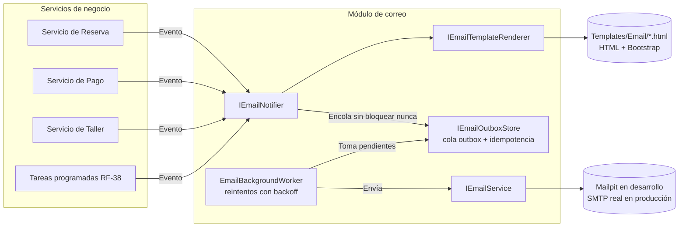
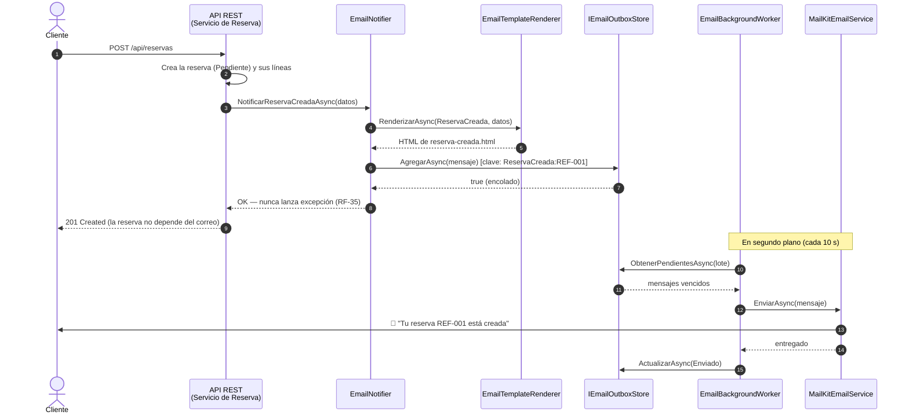
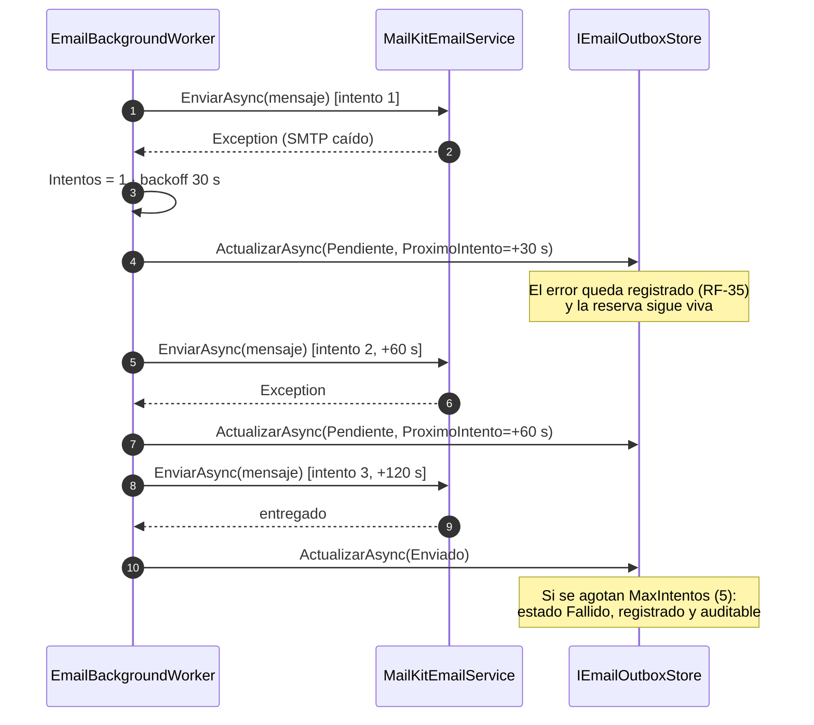
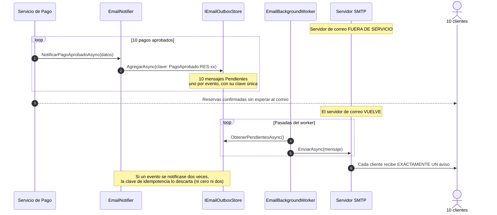

# Notificaciones por correo electrónico — Documentación para la memoria

> Bloque **Correo electrónico (RF-34 a RF-36)** + acuerdos de equipo **CU-12, CU-23 y CU-24**.
> Este documento está listo para volcarse en la *Memoria de diseño* (`docs/`).
> Requisitos cubiertos: **RF-34** (correos en los pasos importantes), **RF-35** (el correo
> nunca bloquea ni rompe la reserva), **RF-36** (correo visible en desarrollo sin salir de la
> máquina), **CU-17** (correo caído con garantía de exactamente una vez, ampliación),
> **CU-12**, **CU-23** y **CU-24** (avisos acordados por el equipo), y apoyo a **RNF-09**
> (registros sin datos sensibles).

---

## 1. Resumen del módulo

El módulo de correo vive en `Alquiler-Vehiculos.Back` y está completamente desacoplado del
resto del negocio: los servicios de reserva, pago, taller y tareas programadas **no envían
correos**: *notifican eventos* mediante `IEmailNotifier` y el módulo se encarga de renderizar
la plantilla, encolar el mensaje y entregarlo con garantías.

| Pieza | Ubicación | Responsabilidad |
|---|---|---|
| `IEmailNotifier` / `EmailNotifier` | `Services/Email/` | Contrato con el negocio: un método por evento. Renderiza, encola y **nunca lanza excepción** (RF-35) |
| `IEmailTemplateRenderer` / `EmailTemplateRenderer` | `Services/Email/` | Renderiza `Templates/Email/*.html` con marcadores `{{Propiedad}}` y bloques `{{#each Coleccion}}` |
| `IEmailOutboxStore` / `InMemoryEmailOutboxStore` | `Services/Email/` | Cola de envío (patrón *outbox*) indexada por **clave de idempotencia** (CU-17) |
| `EmailBackgroundWorker` | `Services/Email/` | Proceso en segundo plano: envía pendientes con **reintentos y backoff exponencial** (RF-35) |
| `IEmailService` / `MailKitEmailService` | `Services/Email/` | Envío físico SMTP con MailKit (inyectable para pruebas) |
| `MemoryEmailService` | `Services/Email/` | Implementación simulada para pruebas (`Email:UseSmtp = false`) |
| `EmailSettings` / `EmailConfig` | `Infrastructure/` | Configuración tipada por entornos (RF-36) y registro en el contenedor DI |
| Plantillas | `Templates/Email/` | 11 plantillas HTML + `assets/email.css` (Bootstrap 5, CSS y JavaScript) |

## 2. Arquitectura del módulo



**Flujo de datos:** evento de negocio → DTO de notificación (`Dto/Email`) → plantilla
renderizada → mensaje en la cola (outbox) → worker en segundo plano → SMTP.

## 3. Diagramas de secuencia

### 3.1 Flujo normal: alta de reserva y confirmación (RF-34, CU-01)



El mismo esquema sirve para el resto de eventos (pago aprobado, recogida, devolución,
cancelación, reembolso...): solo cambia el método de `IEmailNotifier`, el DTO y la plantilla.

### 3.2 Fallo del servidor de correo con reintento (RF-35)



### 3.3 CU-17: correo caído durante una racha de pagos (exactamente una vez)



## 4. Eventos notificados

### 4.1 RF-34 — pasos importantes de la reserva

| Evento | Método de `IEmailNotifier` | Plantilla | Contenido |
|---|---|---|---|
| Alta de reserva | `NotificarReservaCreadaAsync` | `reserva-creada.html` | Vehículo o categoría, fechas, líneas y precio |
| Pago aprobado | `NotificarPagoAprobadoAsync` | `pago-aprobado.html` | Importe, 4 últimos dígitos y cómo recogerla |
| Caducidad | `NotificarReservaCaducadaAsync` | `reserva-caducada.html` | Aviso de caducidad por falta de pago |
| Cancelación | `NotificarReservaCanceladaAsync` | `reserva-cancelada.html` | Acuse con el detalle de la reserva |
| Recogida | `NotificarReservaRecogidaAsync` | `reserva-recogida.html` | Horario de oficina y datos del vehículo |
| Devolución | `NotificarReservaDevueltaAsync` | `reserva-devuelta.html` | Resumen del alquiler y coste final |
| Reembolso | `NotificarReembolsoAsync` | `reembolso.html` | Devolución por anulación (CU-09) o penalización (CU-13) |
| Arreglo con reservas afectadas | `NotificarAfectacionTallerAsync` | `afectacion-taller.html` | Cambio de vehículo, cancelación o aplazamiento (RF-07) |

### 4.2 Acuerdos de equipo (situaciones especiales)

| Evento | Caso | Método | Plantilla |
|---|---|---|---|
| Avería durante el alquiler | CU-12 | `NotificarAveriaDuranteAlquilerAsync` | `averia-durante-alquiler.html` |
| Vehículo no listo | CU-23 | `NotificarVehiculoNoListoAsync` | `vehiculo-no-listo.html` |
| Devolución tardía (cliente afectado) | CU-24 | `NotificarDevolucionTardiaAsync` | `devolucion-tardia.html` |

### 4.3 Puntos de llamada en el negocio

| Evento | Quién dispara la llamada |
|---|---|
| Reserva creada / cancelada / recogida / devuelta | Máquina de estados de la reserva (RF-31 a RF-33) |
| Pago aprobado / reembolso | Servicio de pago (RF-21, RF-22, CU-09, CU-13) |
| Caducidad | Tarea programada de caducidad (RF-38) |
| Afectación de taller | Servicio de taller al resolver reservas (RF-07) |
| Avería en alquiler / vehículo no listo / devolución tardía | Servicio de reserva (CU-12, CU-23, CU-24) |

> **Contrato con el equipo:** basta inyectar `IEmailNotifier` y llamar al método del evento con
> su DTO (`Dto/Email`). La llamada es una línea, no lanza excepción y no retrasa la respuesta.

## 5. Decisiones de diseño

Todas con la alternativa descartada y el motivo, como exige la entrega.

| # | Decisión | Alternativas descartadas | Justificación |
|---|---|---|---|
| 1 | **Patrón *outbox***: el correo se encola y lo envía un `BackgroundService` | Envío directo desde el servicio de negocio; cola tipo `Channel`/`ConcurrentQueue` en memoria (la que usan las implementaciones de ejemplo) | RF-35 exige que el correo nunca bloquee ni rompa la reserva y que el error quede **registrado para reintentarlo**. Con envío directo, un SMTP caído retrasa o rompe la petición. Con una cola solo en memoria, los mensajes se pierden al reiniciar la aplicación. El outbox deja constancia del mensaje y su estado (`Pendiente`, `Enviado`, `Fallido`) |
| 2 | **Clave de idempotencia** por evento (`{Tipo}:{CodigoReferencia}`) | Confiar en que cada evento se notifica una sola vez | CU-17 pide *"ni cero ni dos"* correos por cliente. Ante reintentos, reinicios o dobles llamadas (el enunciado advierte de carreras), la clave única hace que el segundo encolado se descarte |
| 3 | **Reintentos con backoff exponencial** (30 s · 60 s · 120 s…, máx. 5) en el worker | Un único intento; reintento inmediato; Polly con *circuit breaker* (reintentos con apertura de circuito) | Cumple RF-35 sin saturar un SMTP caído. Polly es una mejora válida (la dejamos como ampliación) pero añade una dependencia para algo que el worker resuelve con pocas líneas y es más fácil de explicar y probar. Al agotar intentos, el mensaje queda `Fallido` y auditable: *"el sistema no se queda nunca sin dejar constancia"* |
| 4 | **Cuenta SMTP real del proyecto (Gmail)** como envío activo, con **Mailpit** disponible para desarrollo (contenedor en `compose.yaml`) | `MemoryEmailService` que solo loguea; MailHog (abandonado) | RF-36 pide **ver** el correo en desarrollo sin salir de la máquina: Mailpit da SMTP real (puerto 1025) y bandeja web (8025) con los HTML renderizados, y se mantiene como alternativa comentada en la configuración de desarrollo. El equipo decide enviar con la cuenta real del proyecto; Mailpit cubre el escenario de captura local |
| 5 | **Plantillas HTML como ficheros** con marcadores `{{Propiedad}}` y bloques `{{#each}}` | HTML embebido en strings de C#; Razor Light / Scriban; generación por código | El equipo pidió plantillas en HTML, CSS, JavaScript y Bootstrap. Como ficheros se editan y previsualizan sin recompilar y separan diseño de lógica. Un motor de plantillas completo (Razor/Scriban) aportaría condicionales a cambio de una dependencia más; el mini-renderizador cubre el 100 % de las necesidades con ~80 líneas |
| 6 | **MailKit** para SMTP | `System.Net.Mail.SmtpClient` (obsoleto); API de un proveedor de correo (SendGrid, Mailgun) | MailKit es la librería estándar en .NET, soporta TLS/SSL, autenticación opcional (Mailpit no la exige) y permite inyectar `ISmtpClient` para pruebas. Un proveedor de correo ataría el proyecto a un servicio externo de pago (se menciona en la estimación de gastos como opción) |
| 7 | **Interfaz `IEmailOutboxStore` con implementación en memoria** | Implementación EF Core desde el día uno | La base de datos transaccional aún no está decidida por el equipo. La interfaz está pensada para que al fijar EF Core solo se añada una implementación nueva (con tabla y migración) sin tocar el resto del módulo. La versión en memoria indexa por clave de idempotencia, así que el comportamiento observable es el mismo |
| 8 | **Configuración tipada `EmailSettings`** (sección `Email`) con secretos fuera del repositorio | Cadenas sueltas en `appsettings`; credenciales en el código | RNF-03 exige secretos fuera del repositorio. La contraseña va en *user-secrets* en desarrollo y en la variable de entorno `Email__Password` en producción. `Email:UseSmtp=false` permite conmutar al servicio simulado sin cambiar código |
| 9 | **Registros (`ILogger`) solo con tipo y código de referencia** | Registrar destinatario y asunto completos | RNF-09 prohíbe datos sensibles en los mensajes de log. El email del cliente es dato personal: se registra el evento (`TipoNotificacion`) y la `CodigoReferencia`, suficiente para diagnosticar |
| 10 | **Notificador que nunca lanza excepción** | Propagar el error al servicio de negocio | RF-35 literal: *"el envío de correo nunca bloquea ni rompe la reserva"*. Si el encolado falla, se registra el error y la operación continúa; la garantía de entrega la da la cola, no la llamada |

## 6. Configuración por entornos (RF-36)

| Variable | Desarrollo | Producción |
|---|---|---|
| `Email:Host` / `Email:Port` | `smtp.gmail.com` / `587` | `smtp.gmail.com` / `587` |
| `Email:Security` | `Tls` | `Tls` |
| `Email:Username` | `funkopopapi@gmail.com` | `funkopopapi@gmail.com` |
| `Email:Password` | *user-secrets*, nunca en el repositorio | Variable de entorno `Email__Password`, nunca en el repositorio |
| `Email:From` / `Email:FromName` | `funkopopapi@gmail.com` / `Alquiler Vehículos` | Igual que en desarrollo |
| `Email:UseSmtp` | `true`; `false` activa el servicio simulado (pruebas) | `true` |

Alternativa de desarrollo con captura local (RF-36): Mailpit sigue disponible en el
`compose.yaml`; para usarlo se cambia el bloque `Email` de `appsettings.Development.json`
al que viene comentado (`localhost:1025`, sin credenciales):

```bash
# Desarrollo: un solo comando (RNF-05)
docker compose up -d mailpit
# Bandeja de captura: http://localhost:8025
```

## 7. Estrategia de pruebas prevista (RNF-04)

> Aún no implementadas (pendientes de la fase de pruebas del equipo).

| Requisito | Prueba | Nivel |
|---|---|---|
| RF-34 | Cada plantilla renderiza asunto y cuerpo con los datos del DTO (11 casos) | Unitaria (`EmailTemplateRenderer`) |
| RF-34 | `EmailNotifier` encola un mensaje por evento con la plantilla correcta | Unitaria (con `InMemoryEmailOutboxStore`) |
| RF-35 | Con un `IEmailService` que falla, `Notificar*Async` **no lanza excepción** y el mensaje queda encolado | Unitaria |
| RF-35 | El worker reintenta con backoff y, tras agotar `MaxIntentos`, marca `Fallido` | Unitaria (worker con store y sender falsos) |
| RF-36 | El perfil de desarrollo apunta a Mailpit y el correo llega a la bandeja | Integración (contenedor Mailpit, SMTP real) |
| CU-17 | 10 eventos con el SMTP caído → al volver, **exactamente 10** correos, ninguno duplicado; un evento notificado dos veces se descarta por clave | Unitaria + integración |
| RF-36 / RNF-04 | Flujos de Bruno: crear reserva → comprobar en Mailpit que llega el acuse | E2E |

## 8. Glosario para la memoria

- **Outbox**: cola de mensajes pendientes persistida junto al sistema; separa "decidir que hay
  que avisar" de "entregar el aviso".
- **Clave de idempotencia**: identificador único del evento de negocio (`Tipo:Código`); dos
  encolados con la misma clave producen un solo correo.
- **Backoff exponencial**: espera creciente entre reintentos (30 s, 60 s, 120 s…) para no
  saturar un servidor caído.
- **Mailpit**: contenedor con servidor SMTP y bandeja de captura para desarrollo.

## 9. Pendientes del módulo

1. Pasar `IEmailOutboxStore` a EF Core cuando el equipo fije la base transaccional (tabla
   `EmailOutbox` con índice único sobre `ClaveIdempotencia`).
2. Añadir Polly (retry + *circuit breaker*) como ampliación si se decide justificar.
3. Decisión a documentar: los clientes de correo reales (Outlook, Gmail) no soportan
   Bootstrap ni JavaScript; si la práctica exige correos a buzones reales en producción,
   generar variante con estilos *inline* manteniendo las plantillas actuales para desarrollo.
4. Pruebas (apartado 7) y ejemplos numéricos de cada correo en la memoria.
