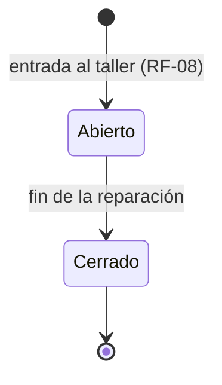

# Partes de taller — Documentación para la memoria

Material para la memoria final del proyecto sobre el módulo de partes de taller (RF-08), su máquina de estados y el procedimiento de taller con reservas afectadas (RF-07). Complementa la entrada de esta tarea en la bitácora de la pareja.

## 1. Resumen del módulo

Cada entrada de un vehículo al taller abre un **parte de taller**: un documento interno con `Id`, `Fecha`, `QuienLoTramita`, `Descripcion`, `Vehiculo` y `Estado` (RF-08). Lo abre y lo cierra un trabajador de tipo `Mecanico` (RF-12); los clientes nunca lo ven (RF-46). Mientras el parte está `Abierto` el vehículo se mantiene en `Mantenimiento`, y solo vuelve a `Disponible` cuando el parte queda `Cerrado` (RF-05, RF-08).

El módulo está diseñado para no depender de las partes que aún no existen: el vehículo se enlaza por su identificador corto de 11 caracteres (RF-01) y el almacén detrás del contrato `IParteTallerRepository` se sustituirá por EF Core cuando se fije la base de datos transaccional.

## 2. Requisitos cubiertos y alcance

| Requisito | Qué aporta este módulo | Estado |
|---|---|---|
| **RF-08** | Partes de taller: apertura, cierre y estados | Implementado |
| **RF-12** | Solo el tipo `Mecanico` abre y cierra partes | Implementado (comprobación en el servicio) |
| **RF-01** | Comprobación de «sin partes abiertos» antes de dar de baja un vehículo | Implementado (`TienePartesAbiertosAsync`) |
| **CU-07** | Ida y vuelta del taller | Parte implementado; la transición del vehículo llega con su módulo |
| **CU-08** | Vehículos en taller con su fecha de entrada | Implementado (`ListarAbiertosAsync`) |
| **RF-05, RF-33** | `Disponible` ↔ `Mantenimiento` sincronizado con el parte | Pendiente del módulo de vehículos |
| **RF-07, CU-12** | Taller con reservas afectadas y avería durante el alquiler | Procedimiento documentado (apartado 4); pendiente del servicio de reservas |
| **RF-37** | Eventos `EntradaTaller` y `SalidaTaller` | Pendiente del módulo de tiempo real |
| **RF-46** | Los clientes no ven partes; matriz de permisos | Visibilidad documentada; matriz pendiente |

## 3. Modelo y máquina de estados del parte

**Campos** (los que pide el enunciado, ni uno más):

| Campo | Contenido |
|---|---|
| `Id` | Identificador del parte |
| `Fecha` | Fecha y hora de entrada al taller (la que consulta el panel, CU-08) |
| `QuienLoTramita` | `Trabajador.Id` del trabajador que lo tramita (RF-12) |
| `Descripcion` | Trabajo que se va a hacer |
| `VehiculoId` | Identificador corto de 11 caracteres del vehículo (RF-01) |
| `Estado` | `Abierto` o `Cerrado` (RF-08) |

**Máquina de estados:**

Reglas que sostienen la máquina:

1. **No se reabren partes.** La única transición es `Abierto` → `Cerrado`. Cerrar un parte ya cerrado responde **409** (`PARTE_YA_CERRADA`, coherente con la regla de transiciones prohibidas de RF-32).
2. **Un solo parte abierto por vehículo.** Un vehículo no puede entrar al taller dos veces sin cerrar el anterior: abrir un segundo parte responde **409** (`PARTE_ABIERTA_EXISTENTE`). La exclusión es atómica en el almacén; en EF Core se garantizará con un **índice único parcial** sobre el vehículo con el parte abierto, la misma garantía declarativa que se exige para la concurrencia de reservas (RNF-01).
3. **Solo `Mecanico` abre y cierra** (RF-12): cualquier otro tipo recibe **403** (`SOLO_MECANICO`) y un trabajador inactivo o dado de baja recibe **422** (`TRABAJADOR_INACTIVO`).
4. **Cada entrada al taller es un parte nuevo**: cerrar libera al vehículo para una futura entrada con su parte correspondiente.

## 4. Procedimiento de taller con reservas afectadas (RF-07)

Decisión del equipo documentada, con la prioridad en la que se resuelven las reservas vivas de un vehículo que necesita ir al taller:

1. **Detectar** las reservas vivas del vehículo (confirmadas o en curso) consultando el servicio de reservas.
2. **Resolverlas por prioridad:**
   1. **Reasignar** al cliente a un vehículo equivalente de la misma categoría (misma `Categoria`, y si la hay, mismo `Acriss`).
   2. Si no hay alternativo disponible o el cliente lo prefiere, **aplazar el arreglo** hasta después de la última reserva afectada.
   3. Si no hay alternativa ni fechas, **cancelar con aviso** y reembolso íntegro.
3. **Avisar al cliente** por correo con el módulo de notificaciones (`IEmailNotifier.NotificarAfectacionTallerAsync`), que distingue cambio de vehículo, cancelación o aplazamiento (RF-34, tabla de correos).
4. **Solo cuando no queden reservas vivas**, abrir el parte y poner el vehículo en `Mantenimiento`. Si alguien intenta meterlo en `Mantenimiento` sin resolver nada, la API responde **409** con el detalle de las reservas a resolver (RF-07).

**Avería durante el alquiler (CU-12):** el vehículo está `EnAlquiler` y el taller lo llama. Se resuelve primero la reserva en curso (fin anticipado, vehículo de sustitución o aplazamiento de la devolución), se avisa al cliente (`NotificarAveriaDuranteAlquilerAsync`), se abre el parte y el coche pasa a `Mantenimiento` sin dejar reservas vivas.

## 5. Decisiones de diseño

**D1 — Patrón `Result<T, DomainError>` con los errores de dominio del proyecto.**
- *Justificación:* el servicio devuelve el error tipado (`ConflictError` 409, `ForbiddenError` 403, `BusinessRuleError` 422, `NotFoundError` 404) y el controlador lo convierte en HTTP con `ToHttpResult()`, igual que el resto de módulos.
- *Alternativa descartada:* lanzar excepciones, que mezclan el flujo de negocio con el transporte.

**D2 — Contrato de repositorio con implementación en memoria, lista para EF Core.**
- *Justificación:* la base de datos transaccional no está fijada para el taller (vivirá junto al módulo de vehículos). La regla «un solo parte abierto por vehículo» se implementa de forma atómica en el almacén y se documenta su garantía declarativa (índice único parcial) para la implementación definitiva.
- *Alternativa descartada:* crear ya un `DbContext` del taller, que pisaría decisiones de modelado que son del conjunto del equipo.

**D3 — El vehículo se enlaza por su identificador de 11 caracteres (RF-01).**
- *Justificación:* el módulo de vehículos no está disponible; el identificador del enunciado es suficiente para todas las reglas del parte. Cuando se fusione ese módulo, `VehiculoId` pasa a ser clave foránea sin tocar las reglas.
- *Alternativa descartada:* esperar al módulo de vehículos para empezar, o copiar su modelo a medias.

**D4 — Orden de comprobaciones: permiso → datos → reglas de negocio.**
- *Justificación:* quien no puede operar en el taller (no `Mecanico`) recibe directamente **403** sin feedback de validación; después se validan los datos (**400** con detalle por campo) y al final las reglas del parte (**409**).
- *Alternativa descartada:* validar los datos primero, que da pistas a quien no tiene permiso.

**D5 — El parte guarda exactamente los campos del enunciado.**
- *Justificación:* el cierre no añade campos: la fecha de entrada está en `Fecha` y el estado en `Estado`. Cualquier campo adicional que necesite el equipo se añade cuando modele el resto de la flota.

## 6. Puntos de integración pendientes

| Punto | Qué se engancha | De quién depende |
|---|---|---|
| Estados del vehículo | `Disponible` ↔ `Mantenimiento` al abrir/cerrar parte (RF-05, RF-33) | Módulo de vehículos |
| Baja de vehículo | `TienePartesAbiertosAsync` para responder 409 con el motivo (RF-01) | Módulo de vehículos |
| Reservas afectadas | RF-07 y CU-12 con el procedimiento del apartado 4 | Servicio de reservas |
| Correos | `NotificarAfectacionTallerAsync` y `NotificarAveriaDuranteAlquilerAsync` | Módulo de notificaciones (ya implementado) |
| Tiempo real | Eventos `EntradaTaller` y `SalidaTaller` (RF-37) | Módulo de tiempo real |
| Permisos | Matriz perfil → endpoint sobre los endpoints del taller (RF-46) | Módulo de permisos |
| Semilla | Partes en distintos estados (RI-03) | Tarea de semilla |

## 7. Estrategia de pruebas aplicada

38 pruebas unitarias (`Alquiler-Vehiculos.Tests/Unit/Taller/`), siguiendo las convenciones de pruebas del proyecto (NUnit + FluentAssertions, patrón AAA con sus comentarios, `Category("Unit")`, nombres `Método_Escenario_Resultado`, dobles a mano):

| Ámbito | Qué se comprueba |
|---|---|
| `ParteTallerServiceTests` | Apertura (datos válidos, validación por campo, no mecánico 403, inactivo/dado de baja 422, parte abierto existente 409, nueva entrada tras cerrar), cierre (ok persistido, 404, ya cerrado 409, no mecánico con el parte intacto, inactivo) y consultas (detalle, 404, abiertos por fecha CU-08, historial, comprobación de RF-01) |
| `InMemoryParteTallerRepositoryTests` | Alta con exclusión atómica del segundo parte abierto, copias independientes, consultas ordenadas por fecha, actualización y contrato de cancelación |
| `AbrirParteValidatorTests` | Formato del identificador de 11 caracteres (RF-01) y de la descripción |
| `TallerConfigTests` | Registro completo del módulo en el contenedor |

Resultado: **38/38 OK** y **cobertura del módulo 211/211 líneas (100 %)** con `dotnet test --collect:"XPlat Code Coverage"`.
